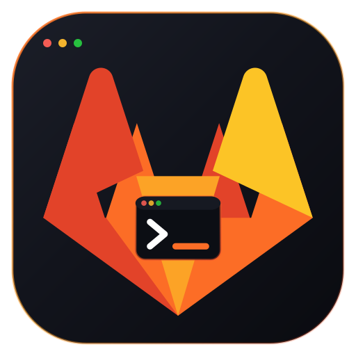

<p align="center">
  
</p>

# lazygitlab

A fast, keyboard-driven terminal UI for [GitLab](https://about.gitlab.com/). Triage merge requests, review diffs, watch pipelines, and manage issues without leaving the terminal.

`lazygitlab` talks to any GitLab instance via the REST API and renders everything with [ratatui](https://ratatui.rs). It is designed to be a daily-driver replacement for the web UI's most common workflows.

## Features
- **Local Git Status:** Shows the current local branch and a dirty marker when run inside a git repository (src/app/mod.rs:4019).
- **Smart Project Selection:** Automatically selects the project if it is the only one available (src/app/mod.rs:350).
- **CLI Arguments:** `--help`, `--version`, `--project`, `--url`, `--token`, `--config` and `--insecure` (src/cli.rs:81).
- **Config file:** `[gitlab]` table in `~/.config/lazygitlab/config.toml`; precedence is CLI, then environment / `.env`, then file (src/config.rs:90).
- **Setup Wizard:** first-run prompt for URL and token when none is configured, optionally saved to `config.toml` with `0600` permissions (src/setup.rs:19).
- **Security:** GitLab tokens, Bearer tokens and the configured token are redacted in logs, error messages and the status bar (src/redaction.rs:58).

### Dashboard & Navigation
- **Personal dashboard** with tabs for Todos, Merge Requests, Issues, Projects, Groups (`src/app/mod.rs:1`)
- **Membership-scoped listing** so you only see projects you belong to (`src/app/mod.rs:266`, fixed in 0.14.4)
- **Home Launchpad & Jump shortcuts** (`g h` / `g t` / `g m` / `g i` / `g b` / `g p` / `g r`) with 8 quick-access cards and contextual focus (`src/models.rs`, `src/ui/list.rs:358`, `src/app/keymap.rs`)
- **Global search** with a dual-strategy (Elasticsearch + scoped) hybrid (`src/app/search.rs:6`, shortcut `f`)
- **Filter-as-you-type** per list (`/`)

### Merge Request review
- **Diff view with inline comments** scoped to a specific line or line range (`src/app/mrs/review.rs`, shortcut `c` in diff)
- **Side-by-side vs unified diff viewer** toggleable with `w`, with binary file indicators and file status badges (`src/ui/diff.rs:18`)
- **Interactive merge dialog** with interactive squash (`s`) and delete source branch (`d`) toggles (`src/ui/popup/confirm.rs:5`)
- **Approve / Unapprove / Merge / Rebase / Squash / Draft toggle / Open-Close** (`A` / `R` / `M` / `E` / `S` / `D` / `c` in detail) — see `src/app/mrs/review.rs`
- **Related MRs & closing issues** shown in the metadata panel (lazy-fetched)
- **Edit metadata in place**: title, description, labels, assignees, reviewers, milestone, target branch
- **Local diff fallback** for GitLab-collapsed diffs and throttled concurrent fetching (`src/app/mrs/diffs.rs`)

### Issues
- **Create / edit / state toggle** (`src/app/issues.rs:449`)
- **Label, assignee, milestone, due/start date, weight** editing
- **Confidentiality toggle** (`src/app/issues.rs:417`)
- **Discussion resolution** (`s` on a thread) and **linked issues / closing MRs** in the metadata panel

### CI/CD
- **Pipelines list** with retry/cancel (`src/app/pipelines.rs`)
- **Job log viewer** with ANSI rendering, section collapsing, follow-mode, multi-line copy (`src/ui/mod.rs:150`)
- **Run new pipeline** with ref + custom variables (`src/app/pipelines.rs:152`)

### Project view
- **Repository tree** with file content viewer and **branch browsing** — press `b` in the file viewer to switch refs (`src/app/global.rs`, `src/ui/popup/tree.rs`)
- **File viewer** with syntect syntax highlighting and independent scroll state (`src/ui/mod.rs:315`)
- **Create / delete branches** from the Branches list (`n` / `D`)
- **Commits history** with pagination (`src/app/global.rs:210`)
- **Branches** list (`src/app/global.rs:250`)
- **Kanban boards** with horizontal scroll, multi-column filter, instant optimistic card moves with `H` / `L`, quick close/reopen (`c`), and shortcut footer (`src/app/mod.rs:3523`, `src/ui/boards.rs:1`)
- **Epics** list per group (`src/app/boards.rs:107`)

### Quality of life
- **Adaptive refresh**: 2s live / 5s active / 30s idle back-off (`src/runner.rs`)
- **Clipboard**: local `arboard` + OSC 52 sequence for remote/tmux sessions (`src/app/mod.rs:3527`)
- **Mouse support** throughout, including scroll-aware list navigation
- **GFM markdown rendering**: aligned tables, task lists, blockquotes, code highlighting (`src/ui/markdown.rs`)
- **Self-expiring footer feedback**: status messages and errors auto-clear
- **Themable** via `theme.toml` (see `theme.toml.example`)
- **Persistent logging** to `lazygitlab.log` (`src/logger.rs`)
- **Command palette via `?`** — searchable help popup with category grouping

## Installation

```bash
# Requires Rust 1.85+ (edition 2024)
cargo install --path .

# Or just build a release binary
cargo build --release
./target/release/lazygitlab
```

## Configuration

Copy and edit the example env file:

```bash
cp .env.example .env
# Then set:
#   GITLAB_URL=https://gitlab.com        (or your self-hosted instance)
#   GITLAB_TOKEN=<your personal access token>
```

The token needs the `read_api` scope to browse, and `api` to perform actions (merge, comment, edit). Prefer `GITLAB_TOKEN` over `--token`, which is visible in the process list; `--token -` reads it from stdin.

Optional theming: copy `theme.toml.example` to `theme.toml` in the working directory (or `~/.config/lazygitlab/`) and edit colors. See the example file for available keys.

Logs are written to `lazygitlab.log` in the working directory (mode `0600` on Unix, tokens redacted; see `.gitignore`).

## Quickstart

```bash
export GITLAB_URL=https://gitlab.com
export GITLAB_TOKEN=glpat-...
cargo run --release
```

Press `?` in the app for the full keybinding list. The most common starting points:

| Key | Action |
| --- | --- |
| `?` | Help / command palette |
| `g t` / `g m` / `g i` / `g p` / `g r` | Jump to Todos / MRs / Issues / Pipelines / Repository |
| `/` | Filter current list |
| `f` | Global search |
| `Enter` | Open detail / select |
| `Esc` | Back / close popup |
| `y` | Copy URL or content to clipboard |
| `o` | Open current item in browser |
| `q` | Quit |

Pipelines & job log:

| Key | Action |
| --- | --- |
| `n` | Launch new pipeline |
| `Shift + j/k` | Extend job-log selection |
| `y` | Copy current job-log line or selection |
| `Tab` / `l` | Toggle job-log section collapse |
| `r` / `R` | Retry a failed job |
| `c` / `C` | Cancel a running job |
| `p` / `P` | Play a manual / skipped job |

## Architecture

```
src/
  main.rs         # binary entry, terminal setup
  runner.rs       # tokio event loop (run_app), adaptive refresh cadence
  app/            # stateful App logic (one module per domain)
    mod.rs        # App struct impl: dispatcher, refresh, shared helpers
    keymap.rs     # handle_key + help/action catalog
    menus.rs      # menu navigation & drill-in flows
    popups.rs     # popup keyboard handling
    mrs/          # merge requests: mod.rs (listing/discussions),
                  # diffs.rs, meta.rs, review.rs
    issues.rs     # Issues, discussions
    pipelines.rs  # CI/CD
    global.rs     # Projects, groups, todos, repo tree/branches
    boards.rs     # Kanban, epics
    search.rs     # Global search hybrid
  ui/             # ratatui renderers
    mod.rs        # top-level frame, popups, job log, file viewer
    list.rs       # list/detail/metadata rendering
    detail.rs     # tabbed detail panel
    diff.rs       # diff view
    boards.rs     # Kanban
    popup/        # one file per popup type (+ tree.rs branch picker)
    markdown.rs   # pulldown-cmark + syntect renderer
    widgets.rs    # Theme, status styles, helpers
  api.rs          # ~65 hand-rolled GitLab REST endpoint types
  models.rs       # DTOs + the App struct definition
  logger.rs       # tracing setup
```

The `App` is a single large struct that owns all UI state. Background API work runs in `tokio::spawn`ed tasks and pushes results back through a `tokio::sync::mpsc::UnboundedSender<DataUpdate>` channel. The event loop (`src/runner.rs`) drains the channel each frame and triggers a redraw.

## Testing

The test suite is split into a hermetic tier (default `cargo test`) and a live tier that talks to a real GitLab instance. All live tests are gated behind `#[ignore]` and resolved via `data/test_ground.json` (a single canonical test ground project).

```bash
# Hermetic: wiremock + unit, no network.
cargo test

# One-time seed of the canonical test ground (idempotent, requires GITLAB_TOKEN).
python scripts/populate_test_ground.py
# Add `--with-massive-mr` to also seed a 120-file MR for `tests/test_massive_mr_diffs.rs`.

# Live smoke: quick end-to-end checks (issue/MR updates, reply to a thread).
# Requires GITLAB_TOKEN and data/test_ground.json.
cargo test -- --ignored live_smoke

# Live full: exhaustive sweep (massive-MR diffs, all entities, all features).
cargo test -- --ignored live_full
```

A `Makefile` (and a `scripts/test.ps1` mirror for Windows) wraps these:

```bash
make test              # wiremock + unit
make seed              # populate test ground
make seed-massive      # populate + 120-file MR
make test-live-smoke   # live smoke
make test-live-full    # live full
make lint              # cargo clippy --all-targets -- -D warnings
make check             # fmt + lint + test (pre-merge gate)
make coverage          # cargo tarpaulin (Linux only)
```

`tests/common/mod.rs` reads `data/test_ground.json` and exposes a single `test_ground()` accessor; every live test must use it (no hardcoded project ids or slugs).

### Headless mode

For snapshot testing and headless CI, the binary supports a `--headless` flag that drives the TUI from a text event script and writes each rendered frame to a directory:

```bash
lazygitlab --headless --width 120 --height 40 --script events.txt --frames-dir out/
```

`events.txt` is a newline-delimited script:
- `q`, `j`, `k`, `<Enter>`, `<Esc>`, `<F1>`, `up`, `down`, ... (named keys)
- `<S-q>`, `<C-r>`, `<A-x>`, ... (modifiers: Shift, Ctrl, Alt)
- `mouse:down:10:5`, `mouse:scroll_down:0:0` (mouse events)
- `#` starts a comment; blank lines are ignored
- `quit` is a shortcut for `q`

Snapshot tests in `tests/headless_snapshots.rs` use [`insta`](https://insta.rs/) to diff the rendered TUI buffer against `tests/snapshots/*.snap`. To accept a new snapshot, run with `INSTA_UPDATE=always cargo test --test headless_snapshots` (or `cargo insta review`).

The test suite has ~80 integration tests across `tests/` covering:

- API mocking with `wiremock` (e.g. `tests/global_search.rs`, `tests/phase3_boards.rs`)
- UI rendering with `ratatui::backend::TestBackend` (e.g. `tests/integration_ui.rs`, `tests/ui_exhaustive.rs`)
- End-to-end key handling (`tests/shortcuts.rs`, `tests/navigation_cycling.rs`)
- User stories (`tests/user_stories.rs`)
- Stress / massive-MR (`tests/test_massive_mr_diffs.rs`, `tests/stress_test_exhaustive_e2e.rs`)
- Membership / metadata caching (`tests/test_project_selection_and_lazy_metadata.rs`)
- API equivalence oracle (`tests/api_equivalence.rs`, `tests/data_update_round_trip.rs`)
- Headless script parser (`tests/headless_script.rs`)
- Headless snapshots via `insta` (`tests/headless_snapshots.rs`)

CI is defined in `.gitlab-ci.yml`: `fmt` + `clippy` + `test:wiremock` on every push, `test:live-smoke` on merge requests and the default branch, `test:live-full` on a nightly schedule and manual trigger, and `coverage:tarpaulin` on a schedule (Linux only).

See [AGENTS.md](./AGENTS.md) for the agent / contributor guide, [ROADMAP.md](./ROADMAP.md) for current state and what's next, and [RELEASING.md](./RELEASING.md) for the release process.

## Acknowledgements

Built on [ratatui](https://ratatui.rs), [crossterm](https://github.com/crossterm-rs/crossterm), [tokio](https://tokio.rs), the [gitlab](https://crates.io/crates/gitlab) crate, [tui-tree-widget](https://crates.io/crates/tui-tree-widget), [ratatui-textarea](https://crates.io/crates/ratatui-textarea), [syntect](https://github.com/trishume/syntect), and [pulldown-cmark](https://github.com/raphlinus/pulldown-cmark).

## License

MIT — see [LICENSE](./LICENSE).
